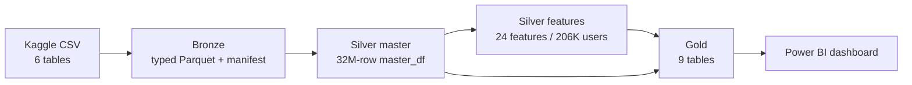
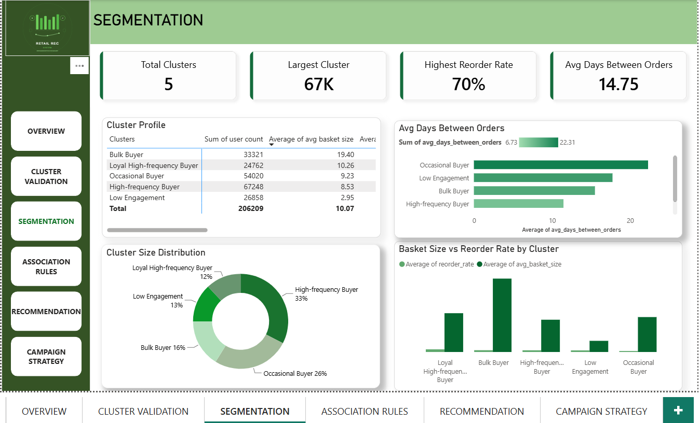

# Retail Recommendation System (Instacart)

End-to-end retail analytics on **32.4M grocery order lines**: a Medallion data pipeline (Bronze–Silver–Gold), customer segmentation, market-basket rules, segment-level product recommendations, and a Power BI dashboard.

Team project (2 members) built during my internship at TMA Solutions Binh Dinh.
Dataset: [Instacart Market Basket Analysis](https://www.kaggle.com/competitions/instacart-market-basket-analysis).

## Business problem

A grocery retailer wants to know who its customers are, what they buy together, and what to recommend to each group. This project turns raw order history into customer segments, cross-sell rules and a recommendation list that a marketing team can act on.

## Architecture



| Notebook | Layer | What it does |
|---|---|---|
| `01new-bronze` | Bronze | Reads 6 CSVs with memory-optimized dtypes, validates structure, uploads Parquet to Supabase, writes a run manifest |
| `02b-silver-master` | Silver | Joins 5 tables into `master_df` (row count asserted equal to source), flags first orders, checks duplicates and nulls |
| `2c-silver-features` | Silver | Descriptive stats, hypothesis tests, 4 feature groups (24 features), scaling for clustering |
| `03ml-gold` | Gold | K-Means, FP-Growth rules, TF-IDF recommendations, dimension and fact tables for Power BI |

## Key findings

- **Reorder behavior:** 59% of all items are reorders. Customers with more orders reorder more (Pearson r = 0.64, p < 0.001).
- **Basket:** average basket is 10.1 items (median 8). Customers with 10+ orders buy larger baskets than those with fewer (Welch t-test, p < 0.001).
- **Category mix:** produce is 29% of all purchases, dairy & eggs 17%. Orders peak at 10:00.
- **Customer segments (K = 5):**

| Segment | Customers | Avg basket | Reorder rate | Days between orders |
|---|---|---|---|---|
| High-frequency Buyer | 67,248 | 8.5 | 45% | 11.5 |
| Occasional Buyer | 54,020 | 9.2 | 26% | 22.3 |
| Bulk Buyer | 33,321 | 19.4 | 47% | 15.5 |
| Low Engagement | 26,858 | 2.9 | 43% | 17.8 |
| Loyal High-frequency Buyer | 24,762 | 10.3 | 70% | 6.7 |

- **Cross-sell rules** (FP-Growth, min support 1%, 213 rules): personal care → household (lift 2.32, confidence 34%), international → canned goods (lift 1.84), dry goods pasta ↔ canned goods (lift 1.84, support 7.3%).

## Dashboard

Pages: Overview · Cluster Validation · Segmentation · Association Rules · Recommendation · Campaign Strategy.




More pages: [Association Rules](images/association_rules.png) · [Cluster Validation](images/cluster_validation.png) · [Recommendation](images/recommendation.png) · [Campaign Strategy](images/campaign_strategy.png)

The Power BI file is in `dashboard/Final_Report.pbix`.

## Limitations

- **Cluster separation is weak.** Silhouette at K = 5 is 0.139 (peak 0.178 at K = 2). K = 5 was chosen so each segment is interpretable for marketing.
- **Recommendations are segment-level, not personalized**, and not yet evaluated offline. `order_products__train` is held out for this.
- **FP-Growth ran on a random 100K-order sample (3.1%)** at department level to keep memory manageable.
- Instacart has no price data, so segment value is measured by behavior, not revenue.

## Team and my contribution

Team project (2 members).

**My part**
- **Data pipeline:** Medallion architecture on Supabase (Parquet) with row-count and integrity checks at each layer; integrated 32M order lines from 5 source tables.
- **Customer analytics:** hypothesis tests, 24 behavioral features for 206K customers, K-Means segmentation (5 segments), FP-Growth association rules.
- **BI:** star schema and the Power BI dashboard (segment insights, recommendation page, campaign strategy).

**Teammate**
- TF-IDF top-10 product recommendations per segment.

## Tech stack

Python (Pandas, NumPy, scikit-learn, SciPy, mlxtend) · Parquet · Supabase Storage · Power BI · Kaggle Notebooks · Git

## How to reproduce

1. Get the dataset from Kaggle and attach it to a Kaggle notebook.
2. Create a Supabase project with three storage buckets: `bronze-data`, `silver-data`, `gold-data`.
3. Add `SUPABASE_URL` and `SUPABASE_KEY` as Kaggle secrets. Never commit them.
4. Run the notebooks in order: `01new-bronze` → `02b-silver-master` → `2c-silver-features` → `03ml-gold`. After each run, copy its `RUN_ID` into the next notebook.

## Repository structure

```
notebooks/   01new-bronze, 02b-silver-master, 2c-silver-features, 03ml-gold
src/         config, io_utils, supabase_utils (helper modules)
dashboard/   Final_Report.pbix
images/      dashboard screenshots
```

## Author

Huỳnh Thị Ngọc Bích · [LinkedIn](https://www.linkedin.com/in/bich-ngoc-383406362/) · ngocbichhuynh0012@gmail.com
