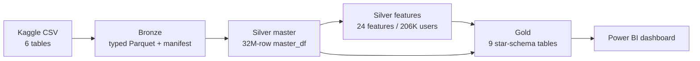
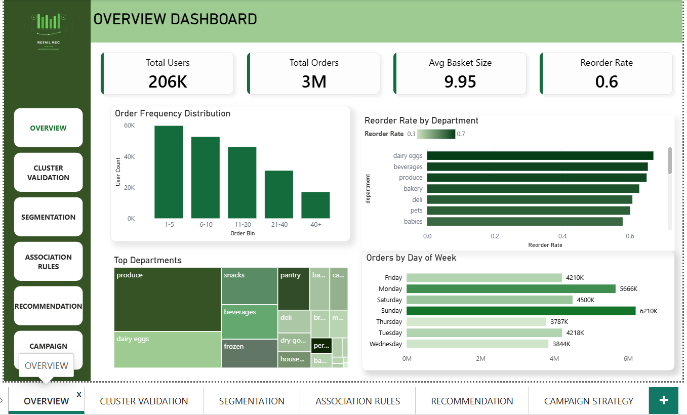
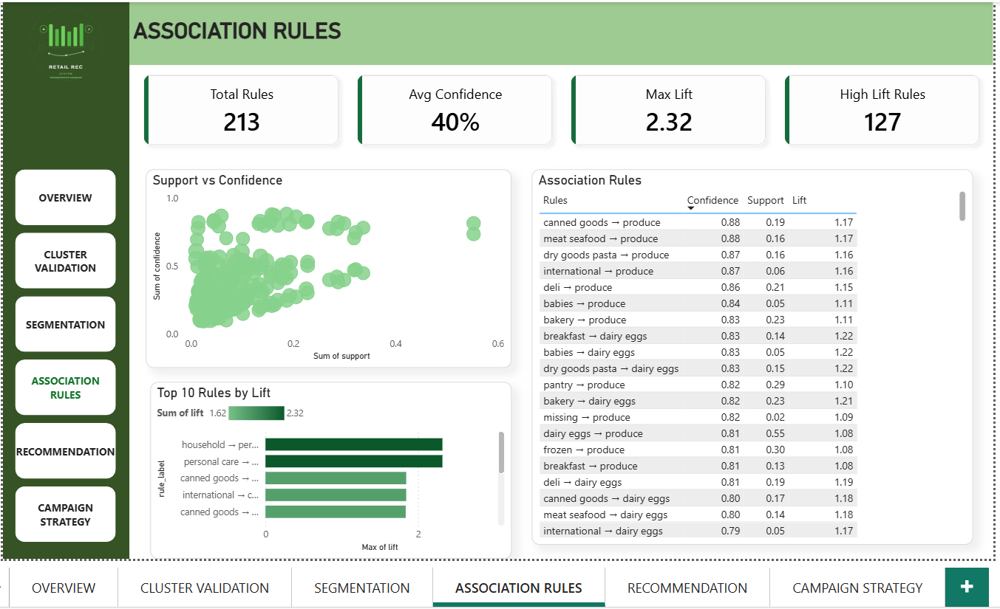

# Retail Recommendation System (Instacart)

End-to-end retail analytics on **32.4M grocery order lines**: a Bronze–Silver–Gold data pipeline, customer segmentation, market-basket rules, segment-level product recommendations, and a Power BI dashboard.

Team project (2 members) built during my internship at TMA Solutions Binh Dinh. Completed in May 2026, published to GitHub in November 2026. Dataset: [Instacart Market Basket Analysis](https://www.kaggle.com/competitions/instacart-market-basket-analysis).

## Highlights

| | |
|---|---|
| Data processed | 32,434,489 order lines · 3,214,874 orders · 206,209 customers · 49,677 products |
| Pipeline | Bronze → Silver → Gold on Supabase (Parquet), with row-count, null, duplicate and foreign-key checks at every layer |
| Features | 24 behavioral features per customer (activity, time habits, product preference, loyalty) |
| Segmentation | K-Means, 5 customer segments (Elbow + Silhouette + Davies-Bouldin) |
| Market basket | 213 department-level association rules with FP-Growth (lift up to 2.32) |
| Recommendations | Top-10 products per segment using TF-IDF scoring |
| Dashboard | 6-page Power BI report on a 9-table star schema |

## Business problem

A grocery retailer wants to know **who its customers are, what they buy together, and what to recommend to each group**. This project turns raw order history into customer segments, cross-sell rules and a recommendation list that a marketing team can act on.

## Architecture



| Notebook | Layer | What it does |
|---|---|---|
| `notebooks/01new-bronze.ipynb` | Bronze | Reads 6 CSVs with memory-optimized dtypes, validates structure, uploads chunked Parquet to Supabase, writes a run manifest |
| `notebooks/02a_eda-on-instacart-data.ipynb` | Exploration | Exploratory analysis of the raw Instacart data |
| `notebooks/02b-silver-master.ipynb` | Silver | Joins 5 tables into `master_df` (row count asserted equal to source), flags first orders, checks duplicates and nulls |
| `notebooks/2c-silver-features.ipynb` | Silver | EDA stats, hypothesis tests, 4 feature groups, scaling for clustering and similarity vectors |
| `notebooks/03ml-gold.ipynb` | Gold | K-Means, TF-IDF recommendations, FP-Growth rules, dimension and fact tables for Power BI |

## Key findings

- **Reorder behavior:** 59% of all items are reorders. Customers with more orders reorder more (Pearson r = 0.64, p < 0.001).
- **Basket:** average basket is 10.1 items (median 8). Customers with 10+ orders buy larger baskets than those with fewer (Welch t-test, p < 0.001).
- **Category mix:** produce is 29% of all purchases, dairy & eggs 17%. Orders peak at 10:00.
- **Customer segments (K = 5):**

| Segment | Customers | Avg basket | Reorder rate | Days between orders |
|---|---|---|---|---|
| High-frequency Buyer | 67,248 | 8.5 | 45% | 11.5 |
| Occasional Buyer | 54,020 | 9.2 | 26% | 22.3 |
| Bulk Buyer | 33,321 | 19.4 | 47% | 15.5 |
| Low Engagement | 26,858 | 2.9 | 43% | 17.8 |
| Loyal High-frequency Buyer | 24,762 | 10.3 | 70% | 6.7 |

- **Cross-sell rules** (FP-Growth, min support 1%): personal care → household (lift 2.32, confidence 34%), international → canned goods (lift 1.84), dry goods pasta ↔ canned goods (lift 1.84, support 7.3%).

## Dashboard

Pages: Overview · Cluster Validation · Segmentation · Association Rules · Recommendation · Campaign Strategy.





More pages: [Cluster Validation](images/cluster_validation.png) · [Recommendation](images/recommendation.png) · [Campaign Strategy](images/campaign_strategy.png)

The Power BI file is in `dashboard/Final_Report.pbix`.

## Limitations and next steps

- **Cluster separation is weak.** Silhouette at K = 5 is 0.139 (the peak was 0.178 at K = 2). I chose K = 5 so each segment is interpretable for marketing, and checked that segment profiles differ clearly (basket size, reorder rate, purchase interval). A next step is to compare HDBSCAN or Gaussian mixtures.
- **Recommendations are segment-level, not personalized**, and are not yet evaluated offline. The `order_products__train` table was held out for this; next step is Hit Rate@10 / MAP@10 on it.
- **FP-Growth ran on a random 100K-order sample (3.1%)** at department level to keep memory manageable. Next step: run on full data with a distributed implementation, and at product level.
- Instacart has no price data, so segment value is measured by behavior, not revenue.

## Team and my contribution

Team project (2 members). I did most of the end-to-end work:

- **Customer analytics:** EDA, hypothesis tests, 24 behavioral features, K-Means segmentation (5 segments), FP-Growth rules and TF-IDF recommendations
- **BI:** 9-table star schema and the 6-page Power BI dashboard, including segment insights and campaign strategy
- **Data pipeline:** Bronze-Silver-Gold architecture on Supabase (Parquet) with validation at each layer
- **Teammate** ([name](https://github.com/rhyni)): TODO one line on their part, e.g. shared helper modules in `src/`

## Tech stack

Python (Pandas, NumPy, scikit-learn, SciPy, mlxtend) · SQL · Parquet · Supabase (PostgreSQL + Storage) · Power BI (DAX) · Kaggle Notebooks · Git

## How to reproduce

1. Get the dataset from Kaggle and attach it to a Kaggle notebook.
2. Create a Supabase project with three storage buckets: `bronze-data`, `silver-data`, `gold-data`.
3. Add `SUPABASE_URL` and `SUPABASE_KEY` as Kaggle secrets. Never commit them.
4. The notebooks import helper modules (`config`, `io_utils`, `supabase_utils`) from `src/` of the team repo [rhyni/retail-recommender-system](https://github.com/rhyni/retail-recommender-system); each notebook clones it in its first cell.
5. Run the notebooks in order: `01new-bronze` → `02b-silver-master` → `2c-silver-features` → `03ml-gold`. After each run, copy its `RUN_ID` into the next notebook.

## Repository structure

```
notebooks/   01new-bronze, 02a_eda-on-instacart-data, 02b-silver-master, 2c-silver-features, 03ml-gold
dashboard/   Final_Report.pbix
images/      dashboard screenshots
```

## Author

Huỳnh Thị Ngọc Bích · [LinkedIn](#) · [Email](#)
